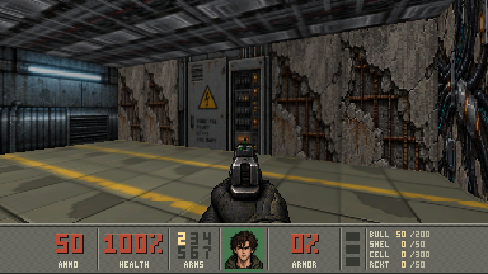
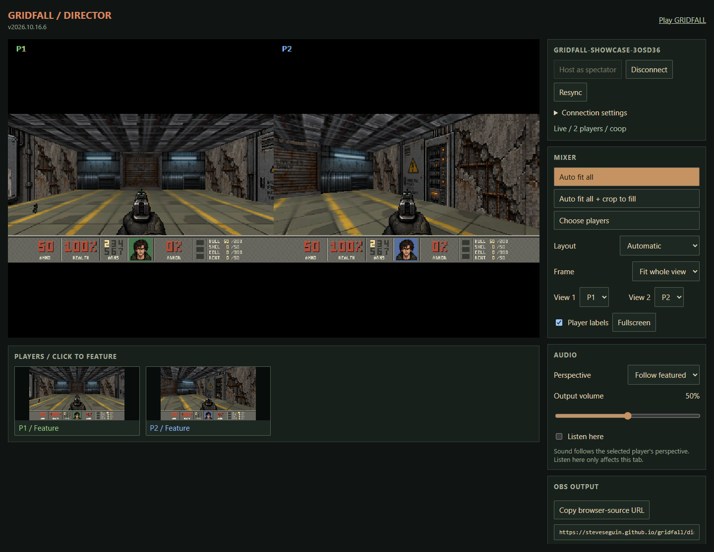

# GRIDFALL

A browser FPS set during a machine takeover: a 24-map campaign, four-player co-op or deathmatch, and a director with a clean OBS output.

**[Play GRIDFALL](https://steveseguin.github.io/gridfall/)** · **[Open the director](https://steveseguin.github.io/gridfall/director.html)**



Choose **New campaign** to play solo. Use the arrow keys to move and turn, **F** to fire, **Space** to use doors and controls, and **Esc** for the menu. Touch controls appear on phones and tablets.

For multiplayer, choose **Multiplayer → Host a game**, then share the **Invite link** from the room menu. Up to four players can join. Keep the host tab open. Connections use the hosted VDO.Ninja service by default; choose another VDO.Ninja installation under **Connection settings**. No camera or microphone is needed. Room invite links include the password when one is set.

The director can watch a room or **Host as spectator**, leaving all four player slots available. Choose a layout, then **Copy browser-source URL** to add the clean output to OBS at 1280 × 720.



Read the **[multiplayer, director and OBS guide](https://steveseguin.github.io/gridfall/guide.html)** for room setup, spectator hosting, layouts, output links, audio, connection recovery, and how peer-to-peer gameplay and local prediction work.

## Run locally

The compiled game is included in `docs/`; no build tools are needed to play:

```sh
python -m http.server 8080 --bind 127.0.0.1 --directory docs
```

Open **http://localhost:8080/**. To play across computers, host `docs/` over HTTPS and share that address.

## Rebuild

Install Python 3.10 or newer and activate [Emscripten 3.1.74](https://emscripten.org/docs/getting_started/downloads.html), then run:

```sh
python -m pip install -r browser/requirements.txt
python browser/build.py
```

This rebuilds the engine and game data directly into `docs/build/`. All required maps, artwork and asset-layout metadata are included. See [BUILD.md](BUILD.md) for setup and editing details.

A standalone [PS1 port and build instructions](ps1/README.md) are also available,
including a browser version recompiled from the PS1 executable.

## License

GRIDFALL code and original game content are provided under the [MIT license](LICENSE). The engine derives from Rebecca Heineman / Olde Skuul's [Doom 3DO source release](https://github.com/Olde-Skuul/doom3do). Its copyright notice is retained. GRIDFALL artwork is AI-generated, music was generated with MIDI-LLM and rendered with the game's synthesizer, and sound effects are synthesized. Original Doom game artwork, recordings and map WADs are not included.

The compiled runtime includes components with their own [license notices](docs/THIRD-PARTY-NOTICES.txt). VDO.Ninja is an external service, not part of this repository's MIT grant.
